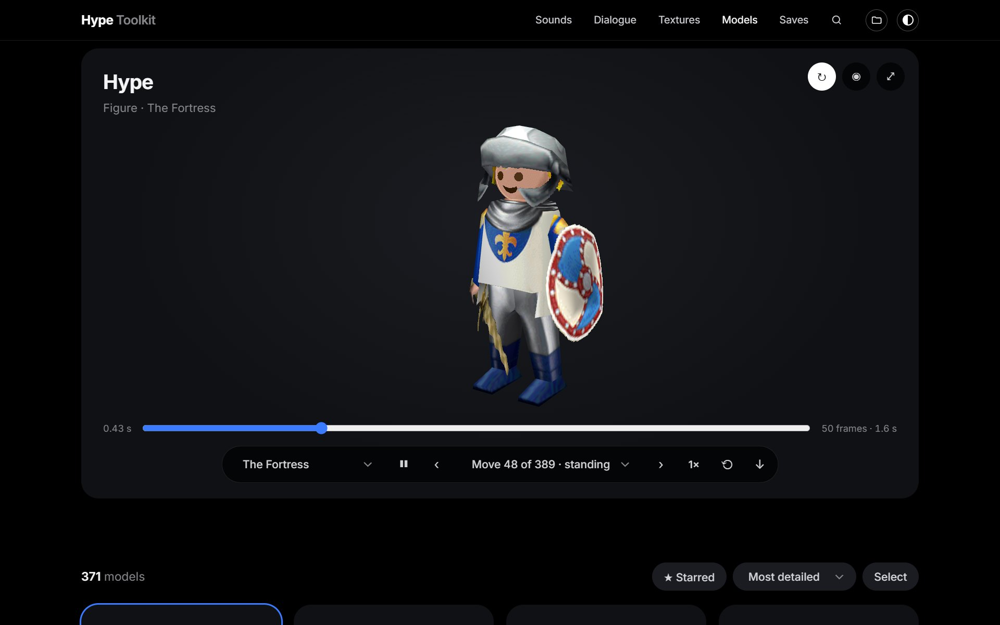
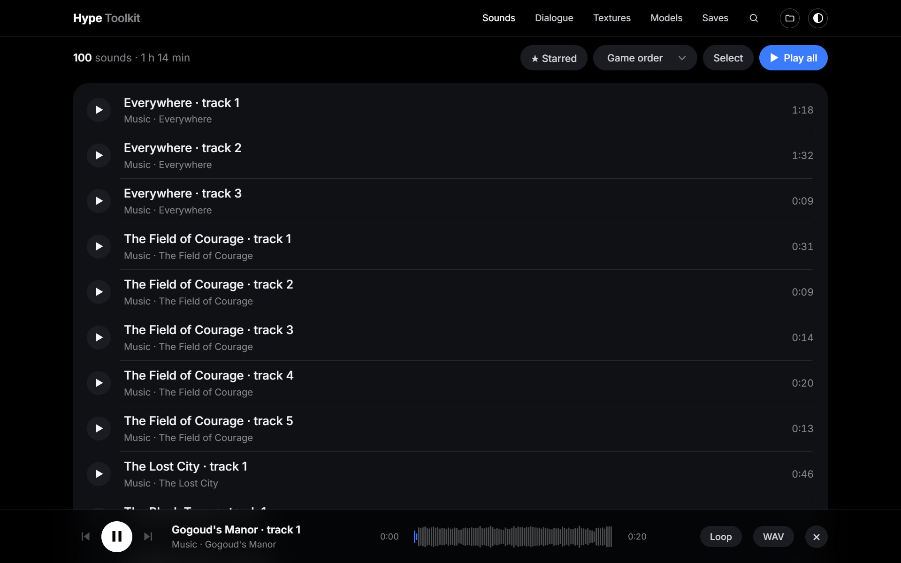

# hypekit

[](https://github.com/eliasehmann/hypekit/actions/workflows/ci.yml)
[](LICENSE)


Browse and export the data of *Hype: The Time Quest* (Ubisoft / Playmobil Interactive, 1999) from your own installed
copy: sounds (with names, levels, speaker and line), dialogue text, textures, 3D characters with their animations, and
save games.

- **Pure Python, standard library only.** Windows, macOS and Linux.
- **Read-only.** Nothing in your game folder is changed.
- **No game files included.** You need your own copy of the game.
- One core, three ways to use it: a desktop **app**, a **CLI** with `--json`, and a **Python / HTTP API**.

| | |
|---|---|
|  |  |

## Install

**Windows app (no Python needed):** download `HypeToolkit.exe` from the
[latest release](https://github.com/eliasehmann/hypekit/releases/latest) and start it. If it can't find the game, it
asks for the game folder once and remembers it.

**From source (any platform, Python 3.10+):**

```
pip install git+https://github.com/eliasehmann/hypekit
hypekit app
```

or without installing: clone the repo and run `python -m hypekit app` inside it.

The game's voices and music are Ubi MPEG streams, which are decoded with
[vgmstream](https://github.com/vgmstream/vgmstream): put `vgmstream-cli` on your `PATH` (or set `$HYPEKIT_VGMSTREAM`).
The Windows app already contains it. Everything else works without it.

## App

```
hypekit app          # window: pywebview if installed, else Edge/Chrome app mode, else the browser
hypekit serve        # just the server: http://127.0.0.1:8765/
```

Every page has search, **Filters** (facet chips with counts), sort, a ★ starred filter, Select → star or export a ZIP,
and Play all. Dialogue reads place by place and plays a whole scene; textures open in a lightbox (←/→, 1×/2×/4×,
checker/black/white); models have speed, a frame scrubber, turntable, PNG snapshot and full screen; saves can be
compared.

Keys: `Ctrl K` quick search · `/` search the page · `J` `K` move · `Enter` play · `S` star · `X` select · `F` filters ·
`Space` pause · `N` `P` next/previous · `[` `]` previous/next move · `Esc` close.

Any page state is in the URL, so views can be bookmarked:
`#/sounds?kind=voice&speaker=Gustus&length=long&sort=long`, `#/dialogue?level=toras&line=toras:5`,
`#/models?id=fort:94c230c&state=5`.

## Python

```python
import hypekit

kit = hypekit.open()                       # or hypekit.open(r'D:\Games\Hype')
kit.sounds('ragoth', kind='voice')         # list of dicts (see `hypekit schema`)
kit.lines(level='brigand2', speaker='GUSTUS')
kit.get('Bnk_116:0')                       # record + linked dialogue lines
open('a.wav', 'wb').write(kit.wav('Bnk_116:0'))
open('t.png', 'wb').write(kit.png('Vignette:0'))
kit.sql('SELECT speaker, count(*) FROM lines GROUP BY speaker')
kit.persos('granslak', wait=True)          # characters (the first call scans every level, ~1 min, then cached)
kit.perso('fort:94c230c')['animations']    # Hype's states
open('hype.glb', 'wb').write(kit.glb('fort:94c230c', state=5))
kit.saves()                                # slots, newest first
kit.save('SaveGame3')                      # health, mana, gold, inventory, spells, armour, story flags
```

Records are JSON-ready dicts with stable ids. `hypekit schema` prints their JSON Schema.

## CLI

```
hypekit info | find <q> | sounds | lines | textures | levels | script <level> | get <id> | export <id>... --out DIR
hypekit persos [q] [--level L] [--all] | glb <perso id> [--state N] [--out FILE]
hypekit saves | save <slot>
hypekit sql "SELECT ..." | schema [sound|line|texture|perso|save] | build [--force]
  --game DIR  --disc DIR (repeatable, .csb sound names)  --cache DIR  --limit N (0 = all)  --json
```

## HTTP API

`hypekit serve` binds `127.0.0.1` only. All `GET`, JSON:

| Endpoint | Returns |
|---|---|
| `/api/info`, `/api/levels`, `/api/schema` | install summary, level list, record schemas |
| `/api/q/<sounds\|lines\|textures\|persos>?<filters>&sort=&limit=&offset=&facets=1` | `{items, total, facets}` (filters: `hypekit/query.py`; a comma means "any of") |
| `/api/find?q=` | quick search across everything |
| `/api/get/<id>`, `/api/script/<level>`, `/api/perso/<id>`, `/api/saves`, `/api/save/<slot>` | single records |
| `/api/wav/<id>`, `/api/png/<id>`, `/api/glb/<perso id>?state=N` | the file itself (Range supported) |
| `POST /api/zip {"ids": [...]}` | a ZIP of WAV/PNG/GLB |

## IDs (stable)

- **sound:** `Bnk_<n>:<node>` (bank entry or track) or `apm:<file>` (stream)
- **line:** `<level>:<n>`
- **texture:** `Textures:<i>` / `Vignette:<i>`
- **perso** (a character placed in a level): `<level>:<superobject hex>`, e.g. `fort:94c230c` = Hype in the Fortress

## Where things come from

- **Game:** `$HYPEKIT_GAME`, then `Ubi.ini` `Directory=`, Program Files, Wine/Proton prefixes. File lookups are
  case-insensitive. Only have the disc? `python tools/disc_to_game.py <disc> <out>` makes a readable copy.
- **Sound designer names (.csb):** only on the disc. Pass the disc folders with `--disc` or `$HYPEKIT_DISCS`.
- **Ubi MPEG (voices, music):** `vgmstream-cli` from `$HYPEKIT_VGMSTREAM`, `vendor/vgmstream/` or `PATH`. Their
  lengths (`seconds`) stay `null` until a bank has been decoded once.
- **Text encoding:** Windows-1252, or Windows-1250 when the install is the Polish release (detected from the text;
  `hypekit info` shows it as `encoding`). Force one with `$HYPEKIT_ENCODING`, for example `cp1250`.
- **Cache:** the catalog and decoded files live in `$HYPEKIT_CACHE`, else `%LOCALAPPDATA%\hypekit`,
  `~/Library/Caches/hypekit` or `~/.cache/hypekit`. It can be deleted at any time; the catalog is rebuilt in about 2 s
  when the install changes.

## Development

```
python -m unittest discover -s tests -v
```

`tests/test_offline.py` runs anywhere (this is what CI runs). The other tests use the auto-detected install and are
skipped without one. See [CONTRIBUTING.md](CONTRIBUTING.md).

The standalone Windows app is built with pywebview + PyInstaller: see the header of
[`tools/build_windows.ps1`](tools/build_windows.ps1). It bundles vgmstream-cli (with its licence) and no game files.
Errors of the windowed build go to `%LOCALAPPDATA%\hypekit\hypekit.log`.

## Roadmap

Own MPEG decoder (no vgmstream needed), macOS/Linux app builds, an MCP wrapper. Changes: [CHANGELOG.md](CHANGELOG.md).

## Legal

hypekit is an unofficial fan project, not affiliated with or endorsed by Ubisoft or Playmobil. *Hype: The Time Quest*
and everything the toolkit shows from your copy of the game (including the screenshots above) belong to their
respective owners. Thanks to the [Raymap](https://github.com/byvar/raymap) project for documenting the engine's file
layouts.

The code is released under the [MIT License](LICENSE). Bundled third-party software (three.js, Inter, and vgmstream in
the Windows app) keeps its own licence: see [NOTICE.txt](NOTICE.txt).
